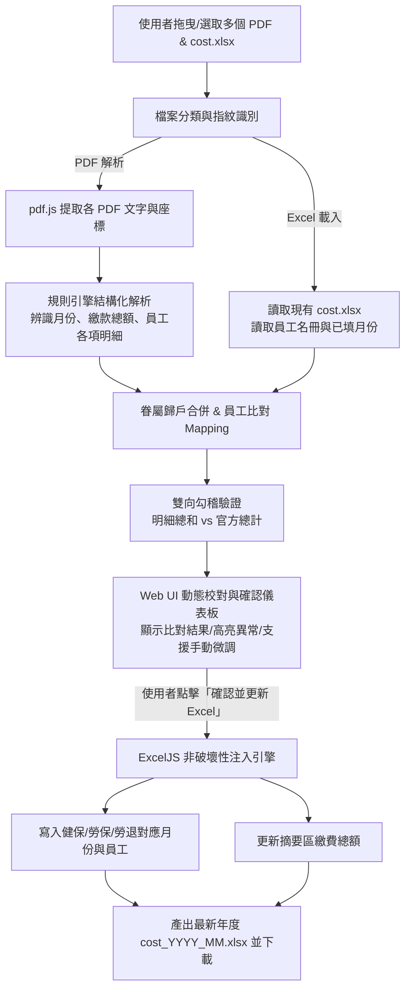

# 人事成本管理系統 (HR Cost Analyzer) 專案規格書與架構設計 (APP.md)

## 1. 專案背景與目標 (Project Context & Objectives)

本系統為「PDF 轉 Excel 智慧轉換工具」在企業人資/財務日常營運中的深度應用，旨在自動化整合每月勞健保與勞退費用，計算公司每月及年度的人事成本。

### 1.1 核心痛點
1. **多來源文件零散**：每月初從勞保局、健保局下載 3~4 份不同格式的 PDF 清冊（勞保、勞退、健保等）。
2. **手動登打耗時易錯**：傳統方式需人工逐一核對員工姓名、自付額、雇主負擔並打入 Excel，且眷屬健保分攤計算繁瑣。
3. **年度單一報表維護**：全年度共用一份 `cost.xlsx`，各月份資料需逐月「累計追加」於特定區塊，且需保留既有的公式（如 `SUMIFS`）及個人分頁連動。
4. **格式經常微調**：政府機關 PDF 版面格式或內部 Excel 欄位若有增減，系統需具備高度設定彈性，避免硬編碼（Hardcode）導致程式失效。

### 1.2 系統目標
* **多檔批量上傳**：一次拖入當月所有 PDF 清冊（3~4 份）及現有年度 `cost.xlsx`。
* **智慧識別與抽取**：自動識別報表類型（勞保/勞退/健保）、年月（如民國 115年08月）、明細名冊與眷屬彙整。
* **雙重勾稽核對**：比對 PDF 明細合計與報表官方總計，並提供視覺化校對確認介面。
* **非破壞性寫入 (In-place Formula-safe Update)**：保留 Excel 所有格式、色彩、合併儲存格及公式連動，僅精確更新該月份欄位。
* **純前端運作安全保障**：所有員工個資（姓名、身分證號、投保薪資）全程於瀏覽器記憶體運作，不上傳任何後端伺服器。

---

## 2. 業務資料來源與對照規則分析 (Data Analysis & Schema Mapping)

### 2.1 來源 PDF 清冊結構

| 報表類型 | 辨識特徵 (Fingerprint) | 擷取欄位 | 重要規則與處理細節 |
| :--- | :--- | :--- | :--- |
| **公司勞保明細** | `投保單位被保險人名冊`、`保費年月` | 姓名、身分證號、投保薪資、個人負擔、單位負擔、異動別 | 依據員工身分證/姓名對應。若有多筆（如中途調薪/退保），依同員工當月負擔累計。 |
| **公司勞退提繳明細** | `勞工退休金計算名冊 － 雇主提繳`、`月提繳工資` | 姓名、身分證號、月提繳工資、退休金 (雇主提繳)、應繳總金額 | 提取雇主提繳金額（退休金），並擷取總應繳金額供勾稽使用。 |
| **機構健保明細** | `投保單位保費計算明細表`、`保費開單年月` | 被保險人/眷屬姓名、身分證號、自付保費、單位負擔、總計保費 | **眷屬歸戶規則**：當出現眷屬列（通常無單位負擔，僅有自付保費）時，自付保費須累加至其主被保險人（員工）項下。 |

### 2.2 目標報表 (`cost.xlsx`) 架構解析

`cost.xlsx` 採用模組化公式串接設計，結構如下：

```
cost.xlsx
├── 使用說明 (Operation Manual)
├── 員工設定 (Employee Roster) ──────► 統一設定員工代號 (E01~E10) 與姓名 (黃色輸入區)
├── 健保 (Health Insurance)
│    ├── Row 1~15  : 年度繳費摘要 (1~12月公司實際支付總額、繳費日期)
│    └── Row 18~140: 員工每月明細 (1~12月各10人，填寫：健保個人負擔、健保公司負擔)
├── 勞保 (Labor Insurance)
│    ├── Row 1~15  : 年度繳費摘要 (1~12月公司實際支付總額、繳費日期)
│    └── Row 18~140: 員工每月明細 (1~12月各10人，填寫：勞保個人負擔、勞保公司負擔)
├── 勞退 (Labor Pension)
│    ├── Row 1~15  : 年度繳費摘要 (1~12月公司實際支付總額、繳費日期)
│    └── Row 18~140: 員工每月明細 (1~12月各10人，填寫：勞退雇主提繳、個人自願提繳)
└── 員工01 ~ 員工10 (Individual Sheets)
     └── 公式自動連動: 透過 SUMIFS 參照 健保/勞保/勞退 之月份與姓名，自動計算人事成本
```

> **關鍵發現與優勢**：
> 員工個人分頁（員工01~10）均已內建 `SUMIFS` 公式連動「健保」、「勞保」、「勞退」分頁。
> 因此，**系統只需精確填寫「健保」、「勞保」、「勞退」三個分頁的當月資料區塊，個人分頁便會自動完成彙整**，不需手動更動個人分頁，大幅降低範本損壞風險！

---

## 3. 系統核心流程 (End-to-End Workflow)



---

## 4. 關鍵模組架構設計 (Modular Architecture)

### 4.1 檔案管理與指紋識別模組 (`file-detector.js`)
* **多檔案拖放支援**：支援一次性丟入 `.xlsx` 與多份 `.pdf`。
* **檔名與內容雙重指紋辨識**：
  * 先以檔名關鍵字初步歸類（如含有 `勞保`、`勞退`、`健保`、`cost`）。
  * 若檔名不規則，讀取第一頁內容關鍵字確認類型。
* **自動年份/月份提取**：
  * 支援民國年（11508、115年08月）與西元年（2026-08）自動轉換為標準格式 `2026-08-01`。

### 4.2 PDF 語意抽取引擎 (`parsers/`)
針對三種主要清冊建立專屬的語意抽取器：
1. `LaborInsuranceParser` (勞保)：
   * 識別名冊起訖列，提取姓名、身分證字號、投保薪資、勞保個人負擔、單位負擔。
2. `LaborPensionParser` (勞退)：
   * 提取序號、姓名、身分證字號、月提繳工資、退休金（雇主提繳金額）。
   * 擷取頂部「應繳總金額」作為校對依據。
3. `HealthInsuranceParser` (健保)：
   * 行層級解析：判斷主被保險人與眷屬行。
   * 眷屬歸屬邏輯：若被保險人下緊接眷屬，將眷屬之自付保費加總至該員工。
   * 擷取「投保單位負擔」及「總計本月實際應繳保險費」。

### 4.3 員工智慧配對模組 (`employee-matcher.js`)
* **姓名精準配對**：優先比對 `員工設定` 工作表中的姓名。
* **模糊/別名對照 (Alias Mapping)**：
  * 允許使用者在前端設定「別名對照表」（例如報表為真實姓名，但 Excel 內為簡寫或外號）。
* **新進員工預警**：若 PDF 中出現的名單未存在於 Excel 的員工名冊中，彈出高亮提示，詢問是否指派給未使用的空名額（如員工05、員工06）。

### 4.4 彈性設定機制 (`config/mapping-config.js`)
為因應未來政府表單排版異動或 Excel 格式變更，所有規則皆抽離為動態設定：
```javascript
const HR_MAPPING_CONFIG = {
  // 健保配置
  healthInsurance: {
    sheetName: "健保",
    summaryMonthCol: "A",
    summaryTotalCol: "B", // 公司實際支付總額
    detailStartRow: 21,
    detailMonthCol: "A",
    detailNameCol: "B",
    detailPersonalCol: "C", // 個人負擔
    detailCompanyCol: "D"   // 公司負擔
  },
  // 勞保配置
  laborInsurance: {
    sheetName: "勞保",
    summaryMonthCol: "A",
    summaryTotalCol: "B",
    detailStartRow: 21,
    detailMonthCol: "A",
    detailNameCol: "B",
    detailPersonalCol: "C",
    detailCompanyCol: "D"
  },
  // 勞退配置
  laborPension: {
    sheetName: "勞退",
    summaryMonthCol: "A",
    summaryTotalCol: "B",
    detailStartRow: 21,
    detailMonthCol: "A",
    detailNameCol: "B",
    detailEmployerCol: "C", // 雇主提繳
    detailPersonalCol: "D"  // 個人自提
  }
};
```

### 4.5 Excel 安全注入引擎 (`excel-updater.js`)
* **維持原始模板完整度**：使用 `exceljs` 原樣載入既有 `cost.xlsx`。
* **動態定位**：不依賴死記的絕對行號，改以「比對月份 (如 `2026-08-01` 或 `8月`) + 比對員工姓名」找到目標儲存格。
* **僅覆寫數值欄位**：
  * 保留儲存格原有的公式參照（如 `SUMIFS`、`='員工設定'!$B$4`）。
  * 保留儲存格邊框、背景填色（黃色/綠色）、字體樣式。
* **多月累積安全寫入**：匯入 8 月份時，1~7 月既有資料完全不受影響。

---

## 5. UI/UX 介面設計規格 (User Interface)

為了達到極致的使用者體驗與專業感，介面規劃如下：

### 5.1 現代化深色/精緻儀表板 (Glassmorphism & Clean Dashboard)
1. **頂部控制列**：
   - 當前作業年份選擇（預設 2026 / 115年）
   - 當月作業月份指示
   - 範本下載按鈕（提供標準 `cost.xlsx` 空白範本）
2. **多功能上傳區 (Upload Zone)**：
   - 支援拖曳多個檔案或點擊選取（支援同時選取 PDF 與 Excel）
   - 檔案辨識清單標籤：
     - `cost.xlsx` [已就緒 - 偵測到 10 位員工]
     - `勞保明細` [已就緒 - 4 人]
     - `勞退明細` [已就緒 - 3 人]
     - `健保明細` [已就緒 - 3 被保險人 + 3 眷屬]
3. **核對與勾稽儀表板 (Verification Panel)**：
   - **卡片 A：費用總覽與勾稽狀態**（綠色打勾表示明細加總 = 報表應繳總額，若有差異顯示警告橘色）。
   - **卡片 B：員工資料對照預覽表**：
     - 表格欄位：員工名稱 | 身分證號 | 勞保個人 | 勞保公司 | 健保個人 | 健保公司 | 勞退雇主 | 勾稽狀態。
     - 允許使用者直接在表格上點擊微調修正數值。
4. **輸出操作區 (Action Bar)**：
   - 一鍵「更新至 cost.xlsx 並匯出」
   - 匯出成功 Toast 提示，並提供檔案下載與備份。
5. **進階設定面板 (Modal / Drawer)**：
   - 提供「欄位對應設定」與「員工別名映射」，具備重設預設值功能。

---

## 6. 系統製作流程與實施路徑 (Implementation Phases)

為了確保開發品質與每一步驟的可驗證性，本專案分為四個實施階段：

### 階段一：核心解析與邏輯驗證 (Core Logic Verification)
1. 建立各 PDF 專屬 parser，驗證能正確抽取出 samples 資料夾中的 11508 勞保、勞退、健保數據。
2. 實現眷屬歸戶演算法與員工比對邏輯。
3. 透過 Node.js 離線腳本進行單元測試，比對提取出的金額與 `cost.xlsx` 預期欄位。

### 階段二：Excel 非破壞性寫入引擎建置 (Formula-safe Excel Updater)
1. 實現讀取現有 `cost.xlsx` 並定位指定月份與員工的功能。
2. 測試寫入 8 月份數據後，確認「員工01~10」個人分頁的 `SUMIFS` 公式計算結果正確無誤。
3. 確認 Excel 樣式、字體、註解、其他月份數據 100% 完整保留。

### 階段三：現代化前端介面與即時核對開發 (Interactive Web UI)
1. 打造支援多檔拖曳、自動辨識標籤的視覺化介面。
2. 建立核對儀表板：即時呈現各險種金額、總計勾稽核對、未匹配人員警示。
3. 整合瀏覽器端 `pdf.js` 與 `exceljs`，達成純前端免伺服器作業。

### 階段四：彈性設定機制與極端情況處理 (Resilience & Documentation)
1. 新增欄位對照與員工映射設定介面（支援 LocalStorage 儲存自訂設定）。
2. 處理 edge cases：
   - 單月同一員工多筆異動（退保/加保）合併。
   - 眷屬單獨加退保處理。
   - 跨年度/不同年份之月份轉換相容性。
3. 完成使用者操作指南與 GitHub 部署。

---

## 7. 驗收標準 (Acceptance Criteria)

1. **準確性**：上傳 samples 中的 11508 三份 PDF，系統能精確辨識出：
   - 勞保：吳金燕（870 / 3087）、易金香（0 / 40）、古力予（0 / 50）、鄭百翔（922 / 3276）。
   - 勞退：吳金燕（2088）、易金香（1998）、古力予（2520），總計 6606。
   - 健保：陳萱蘋（916 / 1428）、歐明安（516 / 1611）、林家羽（含2眷屬合計 1548 / 1611），總計 7630。
2. **完整性**：產出之 Excel 在 Excel 軟體打開時，公式正常運作、無損毀警告、個人分頁數字自動連動計算。
3. **安全性**：無任何資料傳輸到外部網路，瀏覽器 Network 監控為零外部 API 呼叫。
4. **易用性**：使用者只需「拖曳檔案 -> 確認預覽 -> 點擊下載」，三步驟在 30 秒內完成單月作業。
